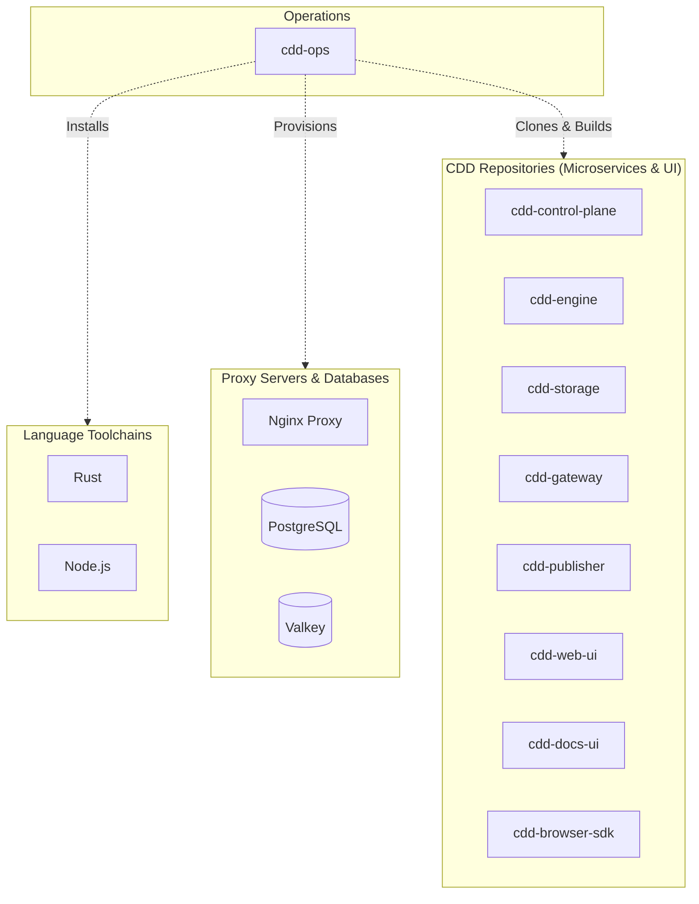
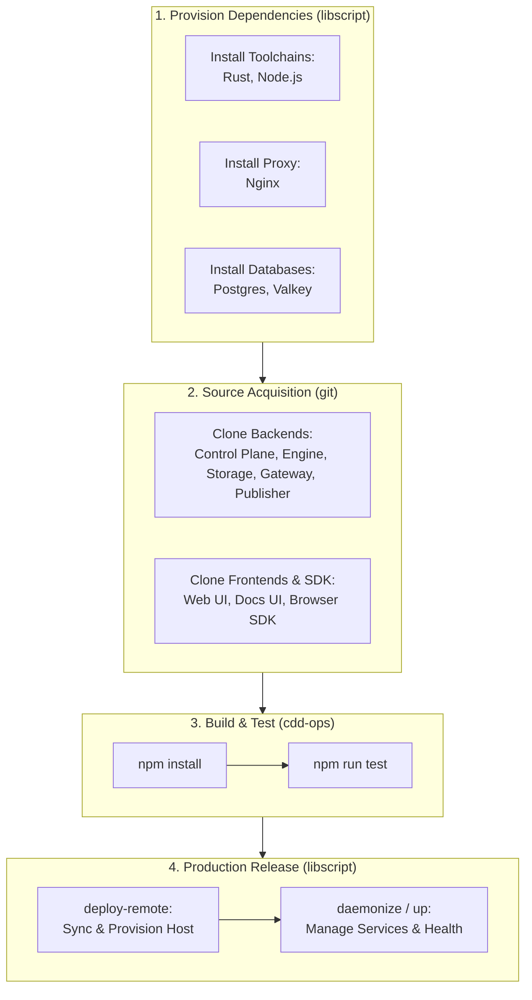

# Deploying with LibScript

This document outlines how to provision and deploy the full CDD platform using `libscript`. The provided deployment scripts replicate the environment setup and project building steps of the `.github/workflows/ci.yml` pipeline.

## Architecture Overview



## Deployment Flow



## Automated Scripts

Two scripts are provided in the repository root for streamlined setup:
- **POSIX (Linux/macOS/FreeBSD):** `deploy_with_libscript.sh`
- **Windows (Command Prompt):** `deploy_with_libscript.cmd`

## What the Scripts Do

1. **Install Dependencies:**
   Utilizing the unified action-first `libscript` CLI and `libscript.json`, the scripts automatically install the necessary core dependencies:
   - Rust (`libscript install rust latest`)
   - Node.js (`libscript install nodejs latest`)
   - Nginx (`libscript install nginx latest`)
   - Postgres (`libscript install postgres latest`)
   - Valkey (`libscript install valkey latest`)
   - Declarative stack dependencies (`libscript install-deps libscript.json`)

2. **Clone Microservices:**
   Just like the GitHub Actions CI workflow, the scripts navigate to the parent directory to clone the necessary CDD repositories alongside `cdd-ops`. This includes:
   - `cdd-control-plane`
   - `cdd-engine`
   - `cdd-storage`
   - `cdd-web-ui`
   - `cdd-browser-sdk`
   - `cdd-docs-ui`
   - `cdd-gateway`
   - `cdd-publisher`

3. **Build the Projects:**
   Finally, the scripts change back into `cdd-ops` to install NPM dependencies and execute the full build/test suite using the native `npm install` and `npm run test` sequence exactly as orchestrated in `ci.yml`.

## Execution

To begin deployment, execute the script corresponding to your operating system from the root of the `cdd-ops` directory.

### macOS / Linux

Make sure the script is executable, then run it:

```sh
chmod +x deploy_with_libscript.sh
./deploy_with_libscript.sh
```

### Windows

Run the batch script via Command Prompt:

```cmd
.\deploy_with_libscript.cmd
```

## Remote Deployment via `deploy-remote` & Service Lifecycle Management

`libscript` features a built-in remote deployment orchestrator (`deploy-remote`, backed by `_lib/cloud/core/deploy_remote.sh`) and an init-system supervisor abstraction (`_lib/init-systems/daemonize.sh` / `daemonize.cmd`), plus native `openssh` component provisioning (`libscript install openssh latest`).

### 1. Idempotent Remote Sync & Provisioning (`deploy-remote`)

Once the local build completes, use `libscript deploy-remote` to synchronize local repositories to a target host over SSH, automatically run `install-deps` and `up` for each application containing a `libscript.json`, and configure the reverse proxy:

```sh
../libscript/libscript.sh deploy-remote deploy@production-server.local
  --sync-dirs="cdd-ops"
  --apps="cdd-ops"
  --health-apps="cdd-ops"
```

### 2. Service Lifecycle & Health Management

Both locally and on remote hosts, `libscript` manages the lifecycle of all services declared in `libscript.json` across native init systems (`systemd`, `openrc`, `runit`, `s6`, `dinit`, `launchd`, FreeBSD `rc.d`, Illumos `smf`, and Windows Services):

```sh
# Start all CDD services and run pre_start/post_start hooks
../libscript/libscript.sh up libscript.json

# Check service status
../libscript/libscript.sh status libscript.json

# Restart or stop the stack
../libscript/libscript.sh restart libscript.json
../libscript/libscript.sh down libscript.json
```

Combining `libscript.json`, `packaging.json`, and `deploy-remote` allows you to script an end-to-end continuous deployment pipeline natively across any operating system.
