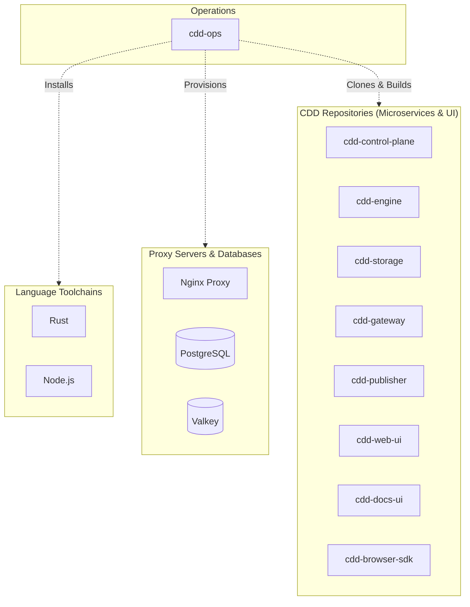
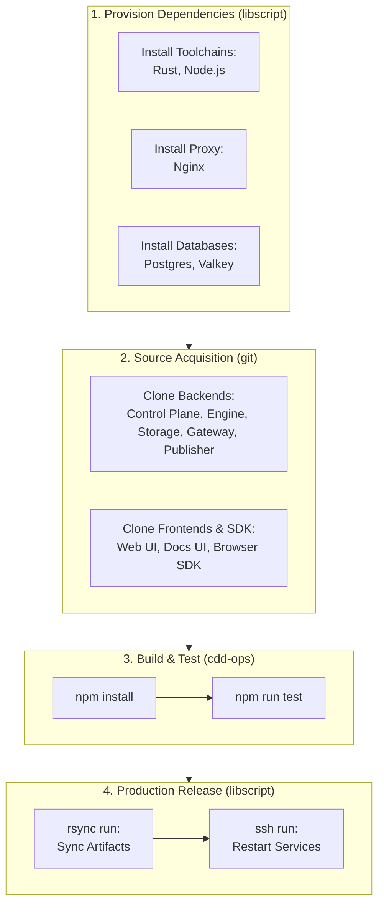

# Deploying with LibScript

This document outlines how to provision and deploy the full CDD platform using `libscript`. The provided deployment scripts replicate the environment setup and project building steps of the `.github/workflows/ci.yml` pipeline.

## Architecture Overview



## Deployment Flow



## Automated Scripts

Two scripts are provided in the repository root for streamlined setup:
- **POSIX (Linux/macOS):** `deploy_with_libscript.sh`
- **Windows (Command Prompt):** `deploy_with_libscript.cmd`

## What the Scripts Do

1. **Install Dependencies:**
   Utilizing the decentralized `libscript` architecture, the scripts automatically install the necessary core dependencies:
   - Rust (`libscript rust install rust`)
   - Node.js (`libscript nodejs install nodejs`)
   - Nginx (`libscript nginx install nginx`)
   - Postgres (`libscript postgres install postgres`)
   - Valkey (`libscript valkey install valkey`)

2. **Clone Microservices:**
   Just like the GitHub Actions CI workflow, the scripts navigate to the parent directory to clone the necessary CDD repositories alongside `cdd-ops`. This includes:
   - `cdd-control-plane`
   - `cdd-engine`
   - `cdd-storage`
   - `cdd-web-ui`
   - `cdd-browser-sdk`
   - `cdd-docs-ui`
   - `cdd-gateway`
   - `cdd-publisher`

3. **Build the Projects:**
   Finally, the scripts change back into `cdd-ops` to install NPM dependencies and execute the full build/test suite using the native `npm install` and `npm run test` sequence exactly as orchestrated in the `ci.yml`.

## Execution

To begin deployment, execute the script corresponding to your operating system from the root of the `cdd-ops` directory.

### macOS / Linux

Make sure the script is executable, then run it:

```bash
chmod +x deploy_with_libscript.sh
./deploy_with_libscript.sh
```

### Windows

Run the batch script via Command Prompt:

```cmd
.\deploy_with_libscript.cmd
```

## Remote Deployment via SSH & Rsync

Because `libscript` serves as a universal orchestrator, it features built-in wrappers for `ssh` and `rsync`. This allows for seamless cross-platform remote deployments, even on systems where these native tools might be absent (such as Windows environments). There is no need to install these components separately as they are natively included.

### 1. Syncing Artifacts to Production

Once the local build process completes, you can use the built-in `rsync` wrapper to push your compiled microservices or static UI assets to a remote server.

For example, to securely sync the output directory to your production environment:

```bash
libscript rsync run -avz --delete ../bin/ deploy@production-server.local:/opt/cdd/bin/
```

### 2. Remote Command Execution

You can orchestrate remote lifecycle events without leaving the `libscript` ecosystem by utilizing the `ssh` component.

After syncing your updated binaries, you might need to restart the services or execute a remote orchestration command. You can do this securely:

```bash
libscript ssh run deploy@production-server.local "sudo systemctl restart cdd-gateway cdd-storage"
```

Combining these components allows you to script an end-to-end continuous deployment pipeline natively across any operating system.
